<div align="center">

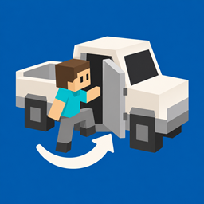

# Superb Warfare: Boarding (卓越前线：登乘演出)

**Model-anchored boarding animations, vehicle-specific riding poses, and physical door/hatch interactions for Superb Warfare vehicles, powered by [AnimCue](https://github.com/kltyton/AnimCue).**

[English](README.md) | [简体中文](README_zh.md) | [Publishing Descriptions & Release Notes](docs/publishing/RELEASE_DESCRIPTIONS.md)

</div>

---

<p align="center">
  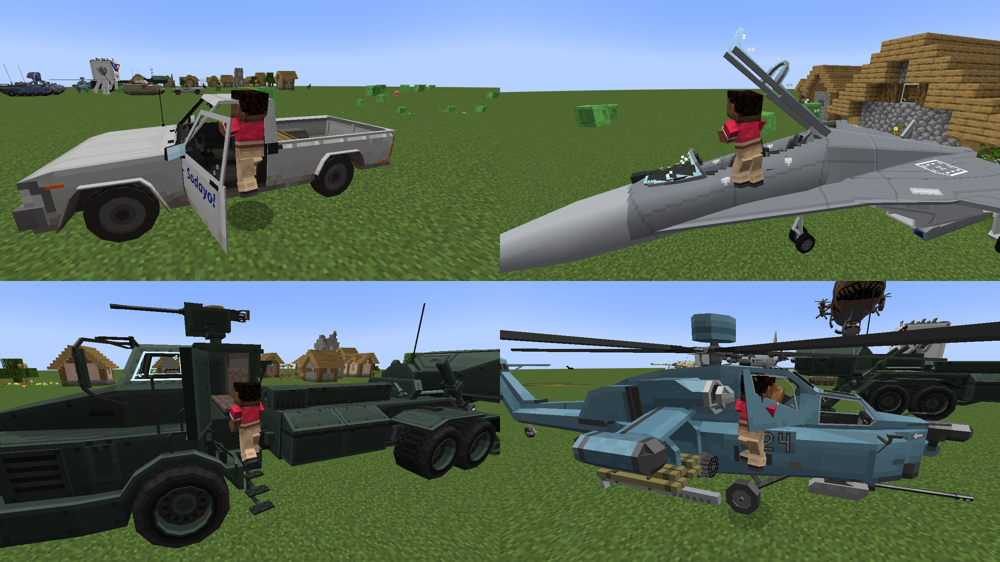
</p>

## Overview

**Superb Warfare: Boarding** (mod ID: `superbwarfare_boarding`) brings fluid, model-anchored boarding & dismounting sequences and custom seated riding poses to rideable vehicles from **Superb Warfare**, powered by **AnimCue** (`interactive_animation`).

Right-click any rideable Superb Warfare vehicle as usual:

- **Fluid Gaits & Surface-Aware Routing**: Walks naturally for short approaches and sprints athletically over longer distances, automatically routing around vehicle hoods, wings, tracks, and obstacles using each vehicle's true visual model geometry and in-game scale.
- **3-Tier Blocked-Entry Fallback (GTA-Style Slide-In)**: If your nearest door is blocked by terrain or walls, the player automatically routes to an accessible alternate door and slides across to the target seat; if every entrance is completely blocked, the interaction seamlessly falls back to native instant mounting so you never get stuck.
- **Model-Anchored Climbs, Doors & Hatches**: Every vehicle class follows trajectories aligned to its stock model parts—swinging cab doors, 4-rung steel ladders, tall vertical airship ladders, landing-gear tires, armored rear doors, hull & turret hatches, fighter LERX wing roots, and sliding/hinged canopies.
- **Custom Seated Riding Poses**: Replaces the stiff vanilla straight-legged sitting posture with tailored bent-knee poses for steering wheels, fighter/helicopter flight sticks, tank/turret crews, open seats, emplacements, and wheelchairs.
- **Physical Door & Hatch Closing on Dismount**: On stationary dismount, players step cleanly down onto safe ground, turn to face open cab/rear doors or hatches, and physically push them shut before regaining normal control. Moving, airborne, and ejection dismounts remain instant.
- **Hold-to-Skip with Compact Circular HUD**: Displays a compact AAA-style circular hold-to-skip ring and localized keybind hint in the bottom-right corner during playback. **Hold Interact (right-click) or Dismount (~0.5 s)** to skip directly into or out of the seat at any time with a live clockwise radial sweep, while filtering accidental single clicks.
- **Smooth Cinematic Camera & Double-Sided Rendering**: First-person views orbit smoothly outside the vehicle during animations and return seamlessly without snapping; vehicle backface culling is temporarily disabled during playback so open doors and interiors render cleanly from every angle.
- **Synchronized Audio**: Keyframe-aligned door/hatch open & close sounds, hull climb steps, seat settling, and block-material-aware footsteps.

Superb Warfare's native locking, menus, vehicle tools, multi-seat controls, moving/airborne dismounts, and ejection behaviors remain completely intact.

---

## In-Game Showcase

| Pickup Door Boarding & Driving Pose | Pickup Dismount & Door Push-Shut |
| :---: | :---: |
| 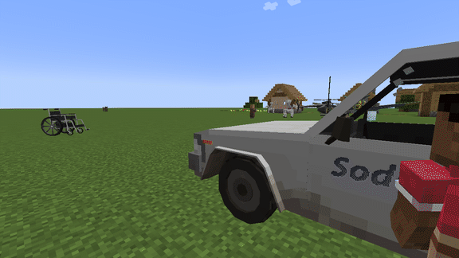 | 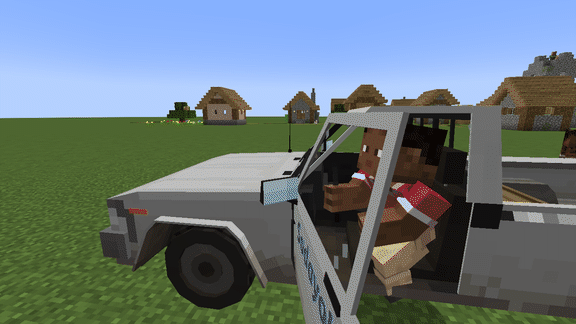 |

| FH-77BW 4-Rung Steel Ladder | LAV-25 Double Rear Doors |
| :---: | :---: |
| 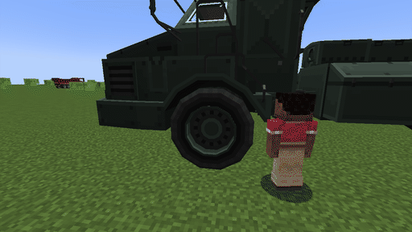 | 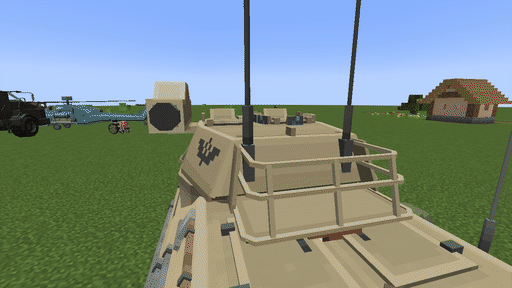 |

| Mi-28 Tire → Sponson → Side Door | J-16 LERX Climb & Canopy |
| :---: | :---: |
| 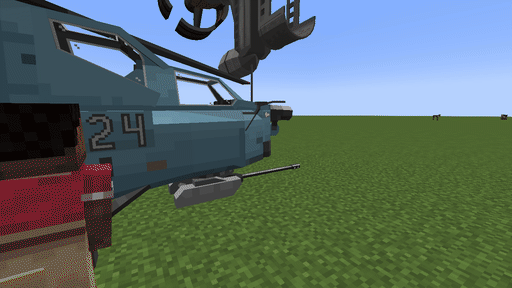 | 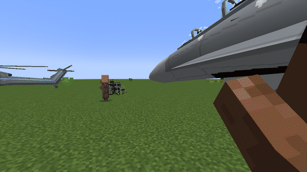 |

| T-90A Main Battle Tank Turret Hatch | YX-100 Visual-Surface Tank Climb |
| :---: | :---: |
| 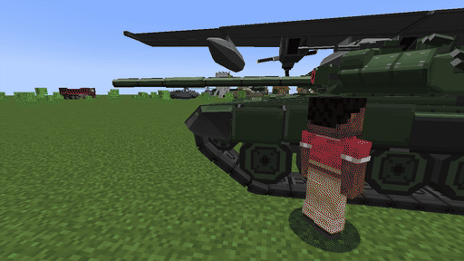 | 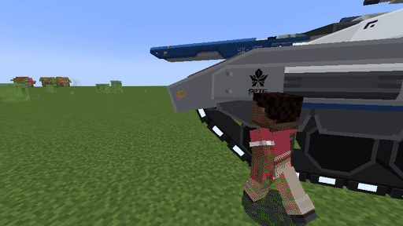 |

| ZTZ-99A Sprint-Around & Commander Hatch | PLZ-05 Front Hull Driver Hatch |
| :---: | :---: |
| 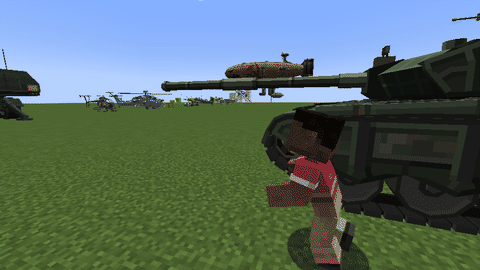 | 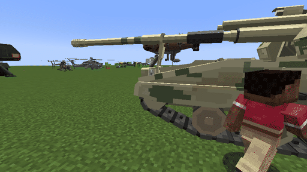 |

<p align="center">
  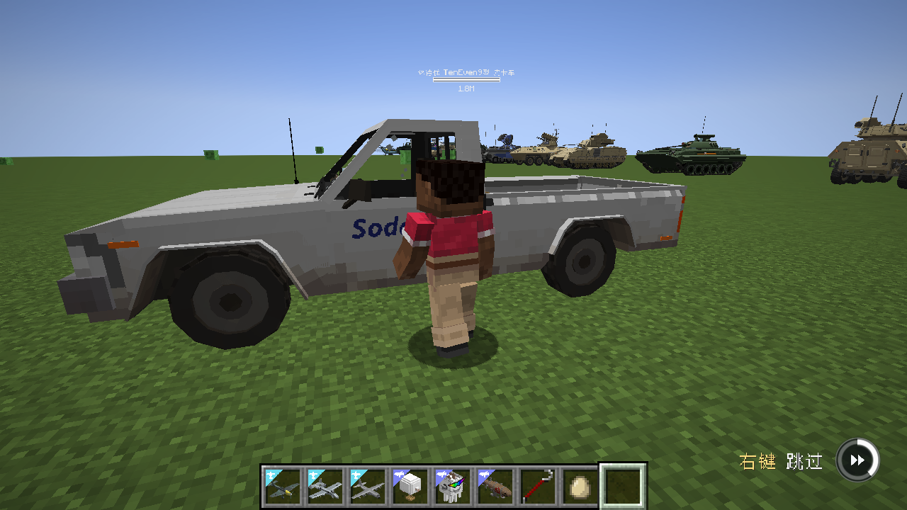
  <br />
  <sub>Compact AAA-style bottom-right circular hold-to-skip ring and clockwise fill prompt displayed during playback</sub>
</p>

---

## Vehicle Coverage Highlights

- **Civilian & Heavy Trucks**: Sodayo Pickup series (`sodayo_pick_up*`), Heavy Truck (`truck`, stepping onto metal side footsteps with wide cab doors), and FH-77BW self-propelled howitzer (`fh_77bw`, routing around the hood, climbing its 4-rung steel cab ladder, and opening the front-hinged door).
- **IFVs & APCs**: Bradley (`bradley`, rear inset personnel door), LAV-25 & LAV-AD (`lav_25`, `lav_ad`, rear double doors with two-handed close), BMP-2 (`bmp_2`), and LAV-150 (`lav_150`).
- **Tanks & SPGs**: T-90A (`t_90a`), ZTZ-99A (`ztz_99a`), M1A2 (`m_1a_2`), YX-100 (`yx_100`), PLZ-05 (`plz_05`, hull driver hatch + turret hatches), and Prism Tank (`prism_tank`) with true-scale fender/track climbs, turret-cheek clearance, and animated hatches.
- **Helicopters & Aircraft**: Mi-28 (`mi_28`, stepping via the main landing-gear tire and sponson through the armored side cockpit door), J-16 (`j_16`), A-10A (`a_10a`), Ju 87 (`ju_87`), AH-6 (`ah_6`), and AC-130H (`ac_130h`).
- **Boats, Airships & Emplacements**: Kirov Airship (`kirov`, tall vertical ladder climb), Happiest Ghast (`happiest_ghast`), Speedboat (`speedboat`), Wheelchair (`wheel_chair`), and Artillery/Defense emplacements.

---

## Requirements

| Platform | Minecraft | Loader | Required Dependencies | Optional Limb/Torso Bending |
| --- | --- | --- | --- | --- |
| **NeoForge** | `1.21.1` | NeoForge `21.1.248+` | [AnimCue](https://github.com/kltyton/AnimCue) (`interactive_animation >= 0.1.1`), Superb Warfare (`>= 0.8.9.2`), GeckoLib, Kotlin for Forge | Player Animation Library (PAL) + PAL More Rotation |
| **Forge** | `1.20.1` | Forge `47.4.22+` | [AnimCue](https://github.com/kltyton/AnimCue) (`interactive_animation >= 0.1.1`), Superb Warfare (`>= 0.8.9.2`), GeckoLib, Kotlin for Forge, MixinExtras (`>= 0.3.6`, provided by Superb Warfare) | playerAnimator + bendy-lib + PAL More Rotation (Forge) |

All dependencies are installed side-by-side (no Jar-in-Jar bundling).

---

## Building from Source

Run the Gradle wrapper from the target directory you want to build:

```bash
# NeoForge 1.21.1
cd targets/neoforge-1.21.1
../../gradlew build verifyDistribution

# Forge 1.20.1
cd targets/forge-1.20.1
../../gradlew build verifyDistribution
```

Optional Gradle properties for local builds:
- `-PinteractiveAnimationJar=<path>` — point to a local AnimCue JAR for the matching loader/version.
- `-PsuperbWarfareJar=<path>` — point to a local Superb Warfare JAR.
- `-PpalMoreJar=<path>` — point to a local PAL More Rotation Forge 1.20.1 JAR when compiling the Forge target.

---

## License

Licensed under the **GNU Lesser General Public License v3.0 or later** ([LGPL-3.0-or-later](LICENSE)).
All vehicle models and textures are provided by your installed copy of Superb Warfare.
