<div align="center">


# 卓越前线：登乘演出 · Superb Warfare: Boarding

**基于 [合拍（AnimCue）](https://github.com/kltyton/AnimCue) 打造的卓越前线（Superb Warfare）全载具实景上下车与驾驶姿态演出附属模组。**

[English](README.md) | [简体中文](README_zh.md) | [发布平台简介与更新日志](docs/publishing/RELEASE_DESCRIPTIONS.md)

</div>

---

<p align="center">
  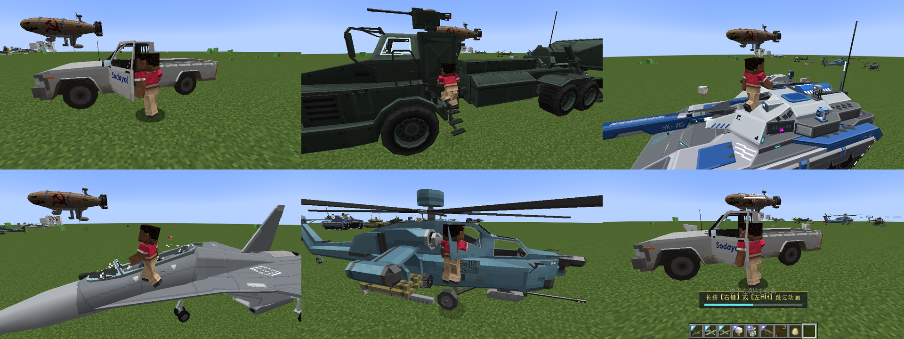
</p>

## 简介

**卓越前线：登乘演出（Superb Warfare: Boarding）**（模组 ID：`superbwarfare_boarding`）为 **卓越前线（Superb Warfare）** 的可乘坐载具注入贴合原车真实几何的上下车演出动画与专属乘坐姿态，底层由 **合拍（AnimCue / `interactive_animation`）** 运行库驱动。

保持你原本的操作习惯，直接右击载具即可触发：

- **自然步态与智能绕行**：近距离自然步行、远距离加速奔跑接近载具；基于各载具真实模型外轮廓与实机缩放自动绕开车头、机翼、履带与邻近障碍物，贴合车身表面攀爬登乘。
- **三段式受阻兜底（GTA 式滑入）**：当目标一侧车门被方块或地形堵住时，优先自动切换另一侧可行车门登车并车内移位至目标座位；若所有入口均完全受阻，则无缝回退为卓越前线原生上车，绝不卡死或中断操作。
- **贴合实车结构的登乘与梯攀**：根据每款载具的真实车门、金属脚踏板、斜钢梯、垂直攀爬梯、起落架轮胎、装甲后门、炮塔舱盖、车体舱盖、机翼边条与座舱盖设计专属路径与联动部件动画，并支持大型空艇与高车体载具的逐级攀爬。
- **载具专属屈膝驾驶与乘坐姿态**：告别僵硬的原版伸腿坐姿，为方向盘驾驶、战斗机/直升机操纵杆、坦克/炮塔乘员、舰艇与露天座位、固定武器与轮椅分别定制自然屈膝与握持姿态。
- **下车物理关门与关盖**：载具停稳下车时，角色踩踏台阶/门槛稳步落地后转身面对敞开的车门、后舱门或舱盖，伸手将其物理推合再恢复操控；行驶中、空中弹射或无安全落脚点时保持原生即时离座。
- **长按跳过动画 + 实时 HUD 提示**：播片期间快捷栏上方自动显示本地化按键提示与实时进度条；**长按交互键（默认右键）或下车键（默认左 Alt / Shift）约 0.5 秒**即可随时跳过演出直接落座或落地，同时屏蔽误触单击。
- **丝滑跟拍镜头与双面渲染**：第一人称自动平滑拉出至载具外侧跟拍，结束后无跳变归位；动画及镜头过渡期间自动关闭载具背面剔除，开门与座舱内部视角清晰通透。
- **关键帧音效同步**：根据脚下方块材质自动播放脚步声，并在服务端按关键帧同步触发开关门、舱盖启闭、金属踏步与落座音效。

完整保留卓越前线原有的载具上锁、工具、菜单、多座位逻辑、行驶离座与弹射体验。

---

## 实机演出展示

| 皮卡开门登乘与驾驶姿态 | 皮卡下车转身关门 |
| :---: | :---: |
| 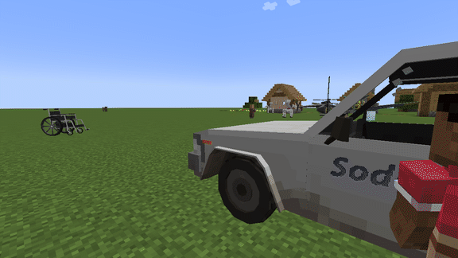 | 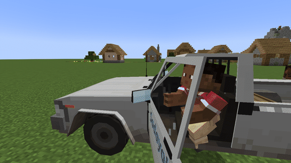 |

| FH-77BW 4 级钢梯登车 | LAV-25 双开后门下车推关 |
| :---: | :---: |
| 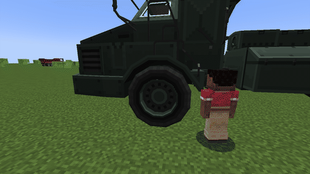 | 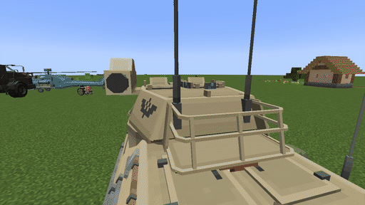 |

| 米-28 轮胎→短翼→装甲侧门 | 歼-16 边条攀爬与座舱盖 |
| :---: | :---: |
| 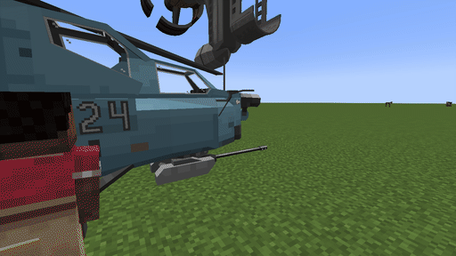 | 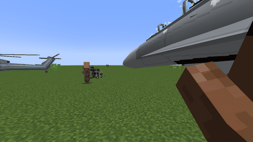 |

| T-90A 主战坦克炮塔舱盖 | YX-100 主战坦克贴面登车 |
| :---: | :---: |
| 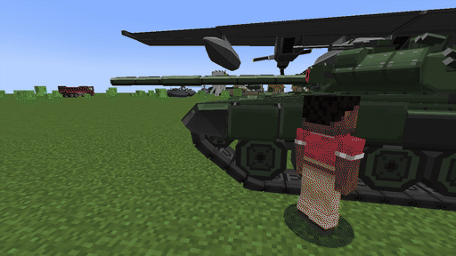 | 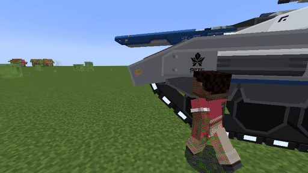 |

| ZTZ-99A 绕前奔跑与车长舱盖 | PLZ-05 车体前舱盖登车 |
| :---: | :---: |
| 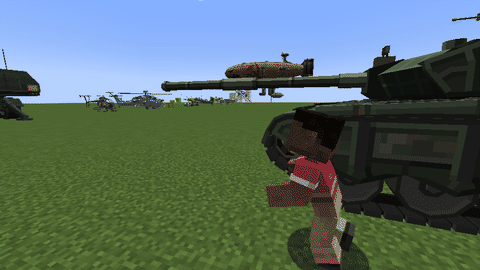 | 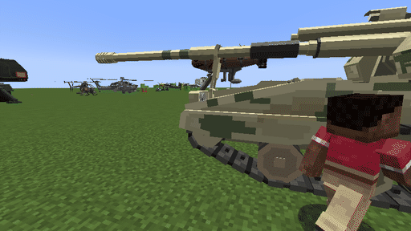 |

<p align="center">
  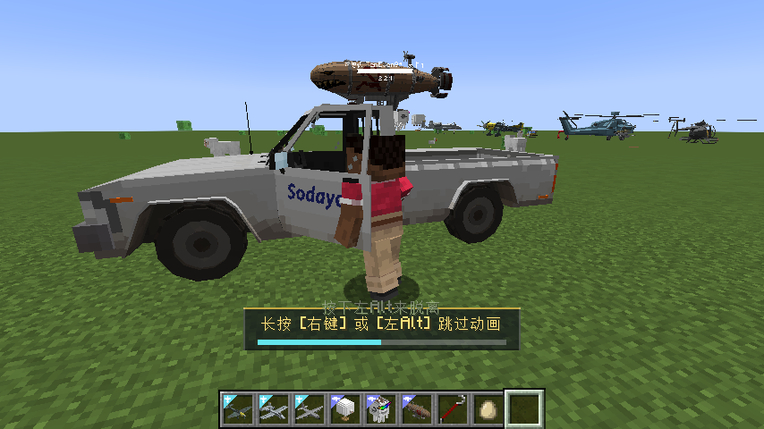
  <br />
  <sub>播片期间快捷栏上方自动显示动态按键提示与长按跳过进度条</sub>
</p>

---

## 特色载具演出一览

- **民用车辆与重型卡车**：Sodayo 皮卡系列（`sodayo_pick_up*`）、重型卡车（`truck`，踩踏实车金属脚踏板与宽角车门）、FH-77BW 自行火炮（`fh_77bw`，绕行车头、逐级攀爬 4 级侧钢梯并拉合前铰链驾驶室门）。
- **步战车与装甲运兵车**：布拉德利（`bradley`，后装甲内嵌小人员门开合与转身推门）、LAV-25 / LAV-AD（`lav_25`、`lav_ad`，双开后门与双手推关）、BMP-2（`bmp_2`）、LAV-150（`lav_150`）。
- **主战坦克与自行火炮**：T-90A（`t_90a`）、ZTZ-99A（`ztz_99a`）、M1A2（`m_1a_2`）、YX-100（`yx_100`）、PLZ-05（`plz_05`，含车体驾驶舱盖与多炮塔舱盖）、光棱坦克（`prism_tank`），完整涵盖贴合实车缩放的履带/侧裙攀爬、炮塔边沿避让、舱盖联动与高台缓冲落地。
- **直升机与固定翼战机**：米-28（`mi_28`，踩踏主起落架轮胎与短翼台阶拉合装甲侧门）、歼-16（`j_16`）、A-10A（`a_10a`）、斯图卡 Ju 87（`ju_87`）、AH-6（`ah_6`）、AC-130H（`ac_130h`）。
- **船艇、飞艇与固定武器**：基洛夫空艇（`kirov`，多级竖梯攀爬登舰）、快乐恶魂（`happiest_ghast`）、快艇（`speedboat`）、轮椅（`wheel_chair`）以及各类炮台与防空阵地。

---

## 安装要求

| 平台 | Minecraft | 加载器 | 必需前置 | 可选肢体/躯干弯曲增强 |
| --- | --- | --- | --- | --- |
| **NeoForge** | `1.21.1` | NeoForge `21.1.248+` | [合拍 AnimCue](https://github.com/kltyton/AnimCue)（`interactive_animation >= 0.1.0`）、Superb Warfare（`>= 0.8.9.2`）、GeckoLib、Kotlin for Forge | Player Animation Library（PAL）+ PAL More Rotation |
| **Forge** | `1.20.1` | Forge `47.4.22+` | [合拍 AnimCue](https://github.com/kltyton/AnimCue)（`interactive_animation >= 0.1.0`）、Superb Warfare（`>= 0.8.9.2`）、GeckoLib、Kotlin for Forge、MixinExtras（`>= 0.3.6`，随 Superb Warfare 提供） | playerAnimator + bendy-lib + PAL More Rotation（Forge 版） |

所有前置均并排安装，模组本体不内嵌第三方依赖包。

---

## 从源码构建

进入对应目标子目录运行 Gradle Wrapper：

```bash
# NeoForge 1.21.1
cd targets/neoforge-1.21.1
../../gradlew build verifyDistribution

# Forge 1.20.1
cd targets/forge-1.20.1
../../gradlew build verifyDistribution
```

可选本地构建参数：
- `-PinteractiveAnimationJar=<路径>`：指定对应加载器与版本的本地 AnimCue JAR。
- `-PsuperbWarfareJar=<路径>`：指定本地 Superb Warfare 发行 JAR。
- `-PpalMoreJar=<路径>`：编译 Forge 1.20.1 目标时指定本地 PAL More Rotation Forge JAR。

---

## 开源协议

本项目基于 **GNU Lesser General Public License v3.0 or later**（[LGPL-3.0-or-later](LICENSE)）发布。载具模型与贴图资源均由用户已安装的 Superb Warfare 本体提供。
