# Superb Warfare: Boarding 发布简介合集

本文件提供 **Modrinth / CurseForge（英文）**、**MCMOD / MC百科（中文）** 以及 **首发版本更新日志（v0.1.0 中英双语）** 的可直接复制发布文案。文中图片与 GIF 均指向仓库 `main` 分支的公开原始链接，推送仓库后即可在各平台直接渲染。

---

## 1. Modrinth / CurseForge 英文简介（直接粘贴 Markdown）

```markdown
# Superb Warfare: Boarding

**Model-anchored boarding & dismounting animations, custom seated riding poses, and physical door/hatch interactions for Superb Warfare vehicles — powered by [AnimCue](https://github.com/kltyton/AnimCue).**

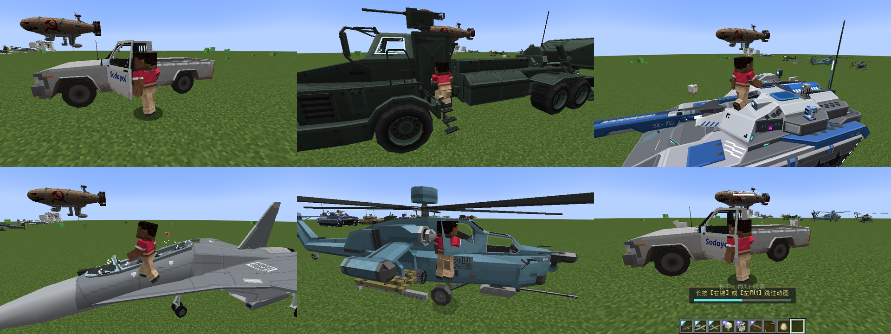

---

### What It Does

**Superb Warfare: Boarding** replaces instant teleport mounting on rideable **Superb Warfare** vehicles with fluid, model-aligned entry and exit sequences and tailored vehicle riding poses—while keeping your familiar controls and every native Superb Warfare mechanic intact.

- **Fluid Gaits & Visual-Surface Routing**: Walks naturally up close and sprints athletically from farther away, routing cleanly around vehicle hoods, wings, tracks, and obstacles using each vehicle's real rendered geometry and scale.
- **3-Tier Blocked-Entry Fallback (GTA-Style Slide-In)**: If your nearest door is obstructed by walls or terrain, the player automatically switches to an accessible alternate door and slides into the target seat. If every entrance is blocked, it seamlessly falls back to instant mounting so you never get stuck.
- **Model-Anchored Doors, Ladders, Canopies & Hatches**: Every vehicle class interacts with its real stock model parts—swinging cab doors, 4-rung steel ladders, tall vertical airship ladders, helicopter landing-gear tires, armored rear doors, tank turret & hull hatches, fighter LERX wing roots, and hinged/sliding canopies.
- **Custom Seated Driving & Crew Poses**: Replaces the rigid vanilla straight-legged sitting posture with vehicle-appropriate bent-knee poses for steering wheels, aircraft flight sticks, tank/turret crews, open seats, fixed emplacements, and wheelchairs.
- **Physical Door & Hatch Closing**: On stationary dismount, players step down cleanly onto safe ground, turn toward open doors or hatches, and push them shut before regaining normal control. Moving, airborne, and ejection exits stay instant.
- **Hold-to-Skip + Live HUD Hint**: A localized keybind hint and live fill bar appear above the hotbar during playback. Hold **Interact (right-click)** or **Dismount** (~0.5 s) anytime to skip straight into or out of the seat, while accidental single clicks are ignored.
- **Smooth Camera & Double-Sided Vehicle Rendering**: First-person views glide smoothly outside the vehicle during animations and return seamlessly afterward. Vehicle backface culling is temporarily disabled during playback so open doors and cabins render cleanly from all angles.
- **Synchronized Audio**: Keyframe-aligned door/hatch sounds, hull climbing steps, seat settling, and surface-aware footsteps.

---

### In-Game Previews

| Pickup Boarding & Driving Pose | Pickup Dismount & Door Push-Shut |
| :---: | :---: |
| 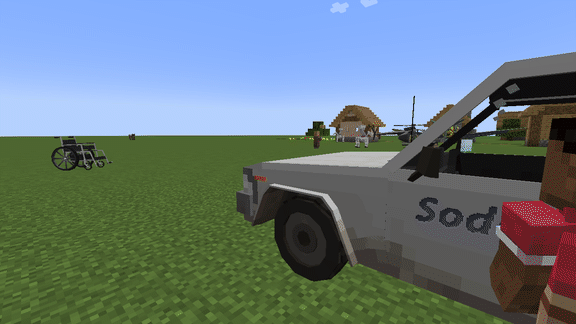 | 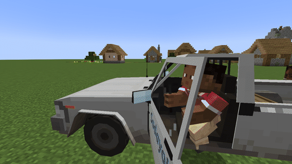 |

| FH-77BW 4-Rung Steel Ladder | LAV-25 Rear Double Doors |
| :---: | :---: |
| 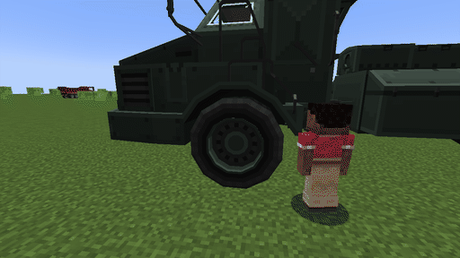 | 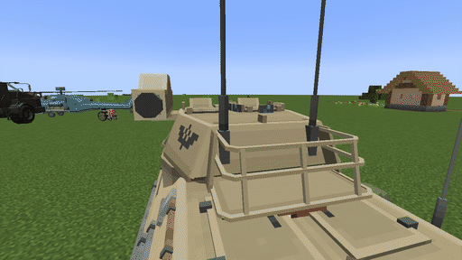 |

| Mi-28 Tire → Sponson → Side Door | J-16 LERX Climb & Canopy |
| :---: | :---: |
| 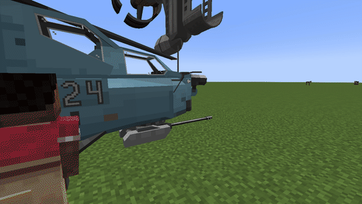 | 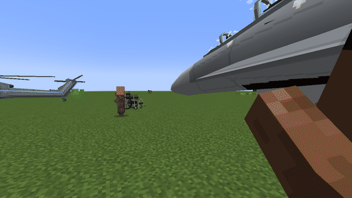 |

| T-90A Turret Hatch | YX-100 Visual-Surface Climb |
| :---: | :---: |
| 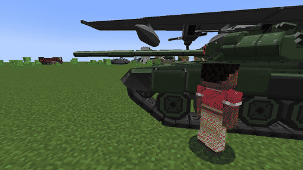 | 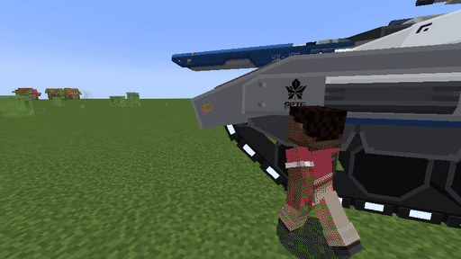 |

| ZTZ-99A Sprint & Commander Hatch | PLZ-05 Front Hull Hatch |
| :---: | :---: |
| 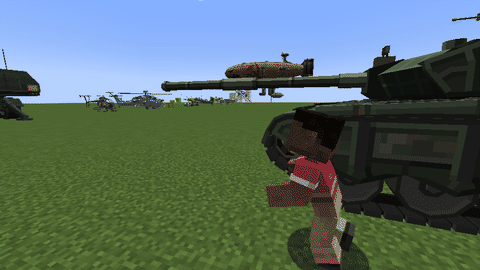 | 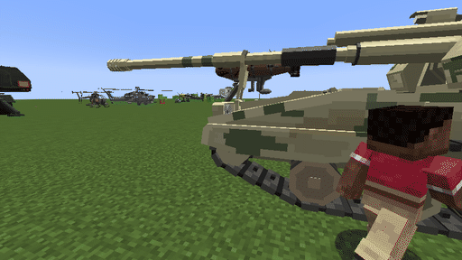 |

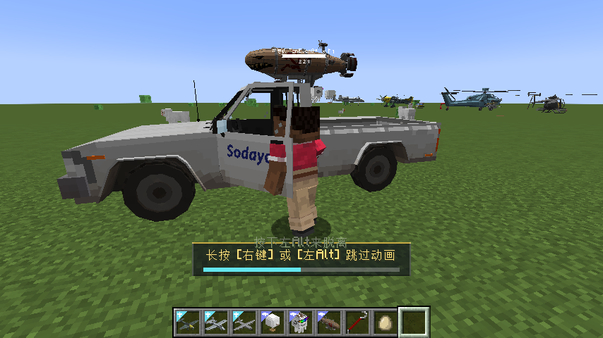

---

### Requirements

- **NeoForge 1.21.1** (`21.1.248+`): **AnimCue** (`interactive_animation >= 0.1.0`), **Superb Warfare** (`>= 0.8.9.2`), **GeckoLib**, **Kotlin for Forge** *(Optional: Player Animation Library + PAL More Rotation for smooth limb/torso bending)*
- **Forge 1.20.1** (`47.4.22+`): **AnimCue** (`interactive_animation >= 0.1.0`), **Superb Warfare** (`>= 0.8.9.2`), **GeckoLib**, **Kotlin for Forge**, **MixinExtras** (`>= 0.3.6`, bundled with Superb Warfare) *(Optional: playerAnimator + bendy-lib + PAL More Rotation Forge)*
```

---

## 2. MCMOD（MC百科）中文简介

### 简短一句话介绍（副标题 / 列表摘要）
> 基于合拍（AnimCue）打造的卓越前线（Superb Warfare）附属模组，为全系列可乘坐载具增加贴合原车模型的实景上下车动画、物理开关门/舱盖、专属屈膝驾驶姿态与长按跳过 HUD 提示。

### 正文简介

**卓越前线：登乘演出（Superb Warfare: Boarding）** 是面向 **卓越前线（Superb Warfare）** 的沉浸式载具登乘演出附属模组，由 **合拍（AnimCue / `interactive_animation`）** 互动动画运行库驱动，支持 **NeoForge 1.21.1** 与 **Forge 1.20.1** 双平台。

无需更改任何按键习惯，直接像原版一样右击载具即可触发完整的实景登乘与离车演出，并完整保留卓越前线原有的载具上锁、工具交互、菜单面板、多座位切换、行驶中跳车与空中弹射机制。

#### 核心特性

1. **自然步态与实车表面避障**
   - 根据玩家与载具的距离自动衔接自然步行与奔跑接近动作。
   - 结合全系列载具的真实模型几何轮廓与实机渲染缩放规划路径，自动绕行车头、机翼与邻近障碍物，贴合车身装甲、履带与炮塔表面攀爬，告别生硬穿模。
2. **三段式受阻兜底（GTA 式备选车门滑入）**
   - 当靠近一侧的车门被墙壁、方块或载具挡住时，角色会自动绕行至另一侧畅通车门上车并移位至目标座位。
   - 若所有入口均完全受阻，将自动平滑回退至卓越前线原生上车方式，不会中断操作或卡在车外。
3. **贴合原车模型的专属登乘与梯攀演出**
   - **民用与卡车**：Sodayo 皮卡拉门登车、重型卡车踩踏金属踏板上车、FH-77BW 自行火炮逐级攀爬 4 级侧钢梯并拉合前铰链驾驶室门。
   - **步战车与装甲车**：布拉德利后装甲小人员门、LAV-25 / LAV-AD 双开后门、BMP-2、LAV-150 贴合车体登乘。
   - **主战坦克与自行火炮**：T-90A、ZTZ-99A、M1A2、YX-100、PLZ-05、光棱坦克等，包含贴合履带/侧裙攀爬、炮塔边沿避让、车体与炮塔舱盖联动开合以及高台缓冲落地。
   - **直升机、固定翼战机与大型空艇**：米-28 踩踏主起落架轮胎与短翼进入装甲侧门，歼-16 / A-10A / 斯图卡 Ju 87 沿翼根边条登机并开合座舱盖，基洛夫空艇多级竖梯攀爬登舰。
4. **载具专属屈膝驾驶与乘坐姿态**
   - 替换原版僵硬的伸直双腿坐姿，根据载具类型自动匹配方向盘驾驶、战机/直升机操纵杆、坦克/炮塔乘员、露天/舰艇乘员、固定炮台与轮椅等自然屈膝与握持姿态。
5. **下车物理关门与关盖**
   - 载具停稳后下车时，角色踩踏门槛或台阶稳步落地，随后转身面向敞开的车门、后舱门或舱盖，伸手将其物理推合后恢复自由操控；高速行驶、空中弹射或无安全落脚点时仍保持原生即时离座。
6. **长按跳过动画 + 实时 HUD 提示条**
   - 播放上下车演出期间，快捷栏上方自动显示本地化按键提示与实时填充进度条。
   - **长按交互键（默认鼠标右键）或下车键（默认左 Alt / Shift）约 0.5 秒**即可随时跳过演出直接落座或落地，同时自动过滤单次误触。
7. **丝滑跟拍镜头、双面渲染与关键帧音效**
   - 第一人称登乘时镜头平滑拉出至载具外侧跟拍，结束后无跳变归位；动画期间自动关闭载具背面剔除，开门与座舱内景清晰无穿帮。
   - 依据脚下方块材质播放真实脚步声，并在服务端按关键帧同步触发开关门、舱盖启闭、金属踏步与落座音效。

#### 前置依赖

- **NeoForge 1.21.1**（`21.1.248+`）：
  - 必需：**合拍 AnimCue**（`interactive_animation >= 0.1.0`）、**卓越前线 Superb Warfare**（`>= 0.8.9.2`）、**GeckoLib**、**Kotlin for Forge**
  - 可选增强：**Player Animation Library（PAL）** + **PAL More Rotation**（开启流畅的关节弯曲与肢体动作）
- **Forge 1.20.1**（`47.4.22+`）：
  - 必需：**合拍 AnimCue**（`interactive_animation >= 0.1.0`）、**卓越前线 Superb Warfare**（`>= 0.8.9.2`）、**GeckoLib**、**Kotlin for Forge**、**MixinExtras**（`>= 0.3.6`，卓越前线已自带）
  - 可选增强：**playerAnimator** + **bendy-lib** + **PAL More Rotation（Forge 版）**

---

## 3. 版本发布日志 · Release Notes (`v0.1.0`)

### 中文更新日志

**卓越前线：登乘演出 v0.1.0 首发版本（支持 NeoForge 1.21.1 & Forge 1.20.1）**

- **全系列载具实景上下车演出**：覆盖皮卡、重卡、FH-77BW、布拉德利、LAV-25/LAV-AD/LAV-150、BMP-2、T-90A、ZTZ-99A、M1A2、YX-100、PLZ-05、光棱坦克、米-28、AH-6、歼-16、A-10A、Ju 87、AC-130H、基洛夫空艇、快艇、快乐恶魂、轮椅及固定炮台等可乘坐载具。
- **真实模型表面防穿模与绕行系统**：基于各载具模型外轮廓与实机渲染缩放进行贴面攀爬与自动绕行，适配炮塔实时旋转、机翼避让与大型空艇/重炮多级竖梯攀爬。
- **GTA 式三段受阻兜底**：近侧车门被阻挡时自动切换对侧可行入口并移位至目标座位，全部入口受阻时无缝回退至原生上车。
- **载具专属屈膝乘坐姿态**：为汽车、战机、直升机、坦克、炮塔、舰艇与轮椅分别定制自然屈膝与操纵握持姿态。
- **物理开关门/舱盖与下车转身推关**：支持车门、双开后门、后装甲人员门、座舱盖、车体舱盖与炮塔舱盖联动动画及关键帧音效。
- **长按跳过动画 + HUD 实时提示条**：播片期间快捷栏上方显示本地化按键提示与进度条，长按交互键或下车键约 0.5 秒即可跳过，同时屏蔽误触单击。
- **丝滑镜头过渡与动画期双面渲染**：第一人称自动平滑外拉跟拍并在结束后无缝归位，播片期间关闭载具背面剔除防止开门内壁透明。

### English Release Notes

**Superb Warfare: Boarding v0.1.0 Initial Release (NeoForge 1.21.1 & Forge 1.20.1)**

- **Model-Anchored Boarding & Dismounting**: Custom entry and exit animations across rideable Superb Warfare vehicles, including pickups, heavy trucks, FH-77BW, Bradley, LAV-25/LAV-AD/LAV-150, BMP-2, T-90A, ZTZ-99A, M1A2, YX-100, PLZ-05, Prism Tank, Mi-28, AH-6, J-16, A-10A, Ju 87, AC-130H, Kirov Airship, Speedboat, Happiest Ghast, Wheelchair, and emplacements.
- **Visual-Surface Clearance & Smart Routing**: Routes around vehicle hulls, hoods, wings, and live-rotated turrets using each vehicle's real geometry and rendered scale, including multi-rung vertical ladder climbs for tall airships and SPGs.
- **GTA-Style 3-Tier Blocked-Entry Fallback**: Automatically routes to an alternate accessible door and slides across to the requested seat when the nearest side is blocked, falling back to native instant mounting if all entrances are obstructed.
- **Custom Seated Riding Poses**: Tailored bent-knee postures for steering wheels, aircraft flight sticks, tank/turret crews, open seats, emplacements, and wheelchairs.
- **Physical Door, Hatch & Canopy Actuation**: Synchronized opening, closing, stationary dismount push-shut sequences, and keyframe-aligned audio.
- **Hold-to-Skip + Live HUD Prompt**: Localized above-hotbar prompt and fill bar; hold Interact (right-click) or Dismount (~0.5 s) to skip animations while accidental single clicks are safely ignored.
- **Smooth Camera & Double-Sided Rendering**: Seamless first-person pull-back/return camera orbit and temporary backface-culling disable during animations for clean door and cabin interiors.
